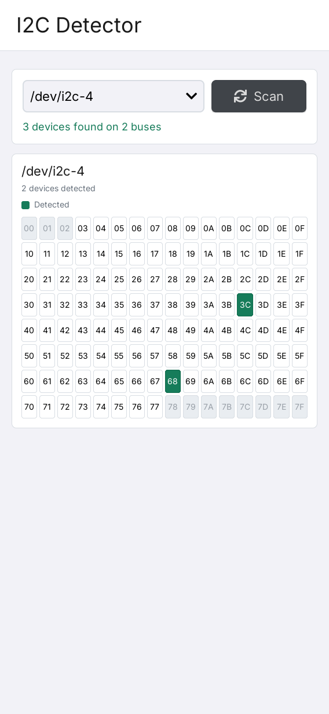

# I2C Detector

**English** | [简体中文](README.zh-CN.md)

I2C Detector is a Linux I2C bus inspector for LILYGO UI, built with C++17,
[LILYGO UI AppKit](https://github.com/LILYGO-UI/cm0-appkit) and LVGL 9.5.
It discovers `/dev/i2c-*` adapters, scans them on a worker thread, and displays
the selected bus as a complete 7-bit hexadecimal address map.

The project provides a CM0 ARM64 Linux build and an SDL2 desktop simulator
for development and testing.

## Preview

<p>
  
</p>

The preview uses deterministic test data: three detected addresses across two
buses, with `/dev/i2c-4` selected.

## Features

- **Automatic discovery:** enumerate bus numbers dynamically and scan all discovered
  adapters when the page opens. Use **Scan** to rescan them.
- **Address map:** display `0x00`–`0x7F`, probe `0x03`–`0x77`, and mute addresses
  outside the probe range. Green cells indicate a successful probe or an address
  already claimed by a kernel driver.
- **Bus selection:** switch between scan results and preserve the selected bus
  across rescans when it is still present.
- **Status reporting:** show address counts, missing adapters, per-bus open errors,
  and scan failures.
- **Responsive interface:** portrait and landscape layouts with a scrollable
  address matrix when space is limited.
- **Background scanning:** keep device I/O off the LVGL thread and publish the
  complete report when the scan finishes.

Scanning requires Linux `i2c-dev` device nodes and read/write access to them.
**The Linux desktop simulator also scans real hardware.** On macOS and other
non-Linux hosts, it reports that scanning is available only on Linux; fixture
buses are supplied by the tests only.

Probing performs SMBus transactions and can affect connected devices. The
conventional address range does not guarantee that every device tolerates a
scan. See [scanning and hardware](docs/02-scanning-and-hardware.md) before
running on a live bus, including how to interpret green cells and empty results.

## Development Environment

Project identity, version, and package metadata come from [`lpm.toml`](lpm.toml).
[`CMakePresets.json`](CMakePresets.json) defines the `host-simulator` and
`cm0-cross` configurations. Run all project commands from the repository root.

### Get the Source

```sh
git clone --recurse-submodules https://github.com/LILYGO-UI/i2c-detector.git
cd lilygo-ui-i2cdetector
```

For an existing checkout, initialize the pinned dependencies:

```sh
git submodule update --init --recursive
```

The presets consume AppKit directly from `third_party/cm0-appkit` through
`find_package(LilyGoUI CONFIG REQUIRED)`. A separate AppKit installation is not
required for the simulator. The bundled LVGL 9.5.0 archive is used by default,
with LVGL network fetching disabled in both presets.

### Host Dependencies

Use CMake 3.21 or later (including CTest and CPack), Python 3.11 or later,
and a C/C++ compiler with C++17 support. The presets use Unix Makefiles;
AppKit also requires `patch` to apply its bundled LVGL patches. SDL2 supplies
the host display and FreeType supplies font rendering. On Linux, the scanner
uses the kernel I2C headers and `ioctl` directly; `i2c-tools` is not required.

#### Debian 12 / Ubuntu 24.04 or Later

```sh
sudo apt update
sudo apt install build-essential cmake git pkg-config patch libsdl2-dev \
  libfreetype6-dev linux-libc-dev python3 python3-venv python3-pip
```

On older distributions, upgrade CMake and Python to the minimum versions above.

#### macOS

Install the Xcode Command Line Tools if needed and dependencies through
[Homebrew](https://brew.sh/). Complete the Homebrew shell setup so that `brew`
and its installed tools are on `PATH`:

```sh
xcode-select --install
brew install git cmake pkg-config patch sdl2 freetype python
```

#### LPM

CMake invokes `lpm metadata --format cmake` during configuration. Install LPM
in a project-local environment using Python 3.11 or later:

```sh
python3 -m venv .venv
. .venv/bin/activate
python -m pip install "git+https://github.com/LILYGO-UI/lpm.git"
lpm --version
```

Reactivate the environment with `. .venv/bin/activate` in each new terminal
before running `lpm`. CMake searches `.venv/bin` as well as `PATH`. An existing
LPM installation can also be selected with
`-DLPM_EXECUTABLE=/absolute/path/to/lpm` during configuration.

Check the host environment before building:

```sh
cmake --version
python --version
pkg-config --modversion sdl2 freetype2
lpm metadata --format cmake
```

### Device Cross Compiler

Skip this step when only building the desktop simulator. Device builds need
a separate AArch64 Linux cross compiler on the development machine.

**Debian / Ubuntu:**

```sh
sudo apt install gcc-aarch64-linux-gnu g++-aarch64-linux-gnu
```

**Apple Silicon macOS:**

```sh
brew install aarch64-unknown-linux-gnu
```

The BSP toolchain expects these executable names on `PATH`:

```sh
aarch64-linux-gnu-gcc --version
aarch64-linux-gnu-g++ --version
```

See [CM0BspBuilder](https://github.com/LILYGO-UI/CM0BspBuilder) for SDK host
and compiler requirements. The BSP supplies target headers and libraries but
does not install the host cross compiler.

## Build and Test

After completing the environment setup, use LPM from the repository root.
It reads the build presets and package output directory from `lpm.toml`.

### Desktop Simulator

```sh
lpm start --foreground
```

This configures and builds the simulator, then starts it in the foreground.
To reuse an existing build, run `lpm start --no-build --foreground`.
The Debug build has tests enabled and is stored in `build/host-simulator`.
Running the application requires a graphical desktop session. Hardware scanning
is available on Linux only and does not require internet access.

### Tests

Configure and build the host simulator, then run all tests:

```sh
lpm test
```

| Test | Coverage |
| --- | --- |
| `i2cdetector-core` | Model states, bus sorting, counts, selection preservation, and empty/error reports |
| `i2cdetector-view-model` | Scan commands, duplicate-start rejection, report polling, bus selection, and Subject updates with a fake scanner |
| `i2cdetector-render-portrait` | Rendering, address colors, bus selection, and rescan button state at `568 x 1232` |
| `i2cdetector-render-landscape` | The same rendering and interaction checks at `1232 x 568` |

Tests use synthetic reports and do not probe hardware. Render tests run without
an SDL window and write `i2cdetector-portrait.ppm` and
`i2cdetector-landscape.ppm` under `build/host-simulator`. Inspect both after UI
changes; passing assertions alone does not verify the visual layout. Follow the
[UI development guidelines](docs/01-user-interface.md) for UI acceptance.
Real adapter discovery and SMBus transactions need separate Linux device validation.

### CM0 Device Build

The device preset targets CM0 Raspberry Pi OS on AArch64, uses a Release build,
disables host tests, and sets the installation prefix to `/usr`.
Cross-compile and create the Debian package:

```sh
lpm pack
```

The first `lpm pack` (or `cmake --preset cm0-cross`) uses the
[toolchain wrapper](cmake/cm0-bsp-toolchain.cmake) to download CM0 BSP `0.1.0`,
verify its pinned SHA-256 checksum, and extract the sysroot to
`.cache/cm0-bsp/0.1.0/sysroot`. The first download requires access to GitHub;
later configurations reuse this cache. To change the cache location, pass
`-DCM0_BSP_CACHE_DIR=/absolute/path/to/cache` when configuring.
No sibling CM0BspBuilder checkout is required.

The SDK sysroot must contain target Linux I2C headers, FreeType, and DRM
libraries and headers. Host libraries cannot substitute for target dependencies.

CPack writes an ARM64 `.deb` to `dist/`. The package installs the executable,
launcher entry and icon, desktop entry, AppStream metadata, and shared-font
license notices. The target system must provide `libc6`, `libstdc++6`, `libdrm2`,
`libfreetype6`, and `lilygo-ui-appkit-dev >= 0.1.0`. AppKit supplies the shared
runtime fonts. The declared `i2c` permission in `lpm.toml` does not load the
kernel driver or grant access to `/dev/i2c-*`; see [hardware setup](docs/02-scanning-and-hardware.md#linux-setup).

<details>
<summary>Underlying CMake commands</summary>

LPM wraps the following steps. You can also run them directly when debugging
the build configuration; LPM is still required to read project metadata.

Host build and tests:

```sh
cmake --preset host-simulator
cmake --build --preset host-simulator --parallel
ctest --preset host-simulator
```

Device build and packaging:

```sh
cmake --preset cm0-cross
cmake --build --preset cm0-cross --parallel
cpack --config build/cm0-cross/CPackConfig.cmake -B dist
```

</details>

### Troubleshooting

| Symptom | Action |
| --- | --- |
| `lpm is required to read project metadata` | Install LPM in `.venv`, put it on `PATH`, or set `LPM_EXECUTABLE`. |
| `LilyGoUI` or bundled LVGL cannot be found | Initialize the pinned AppKit submodule with `git submodule update --init --recursive`. |
| SDL2 or FreeType is missing | Install the host development packages; for cross builds, check the target sysroot. |
| Linux I2C headers are missing | Install `linux-libc-dev` on Debian/Ubuntu; for cross builds, check the target sysroot. |
| Homebrew libraries are not found | Configure with `cmake --preset host-simulator -DCMAKE_PREFIX_PATH="$(brew --prefix)"`. |
| BSP download fails | Check access to GitHub releases and available disk space, then rerun configuration. |
| No buses, permission errors, or no detected addresses | See [hardware troubleshooting](docs/02-scanning-and-hardware.md#troubleshooting). |

## Documentation

| Guide | Contents |
| --- | --- |
| [Scanning and hardware](docs/02-scanning-and-hardware.md) | Linux setup, probe sequence, result meanings, platform differences, and troubleshooting |
| [Architecture overview](docs/00-overview.md) (Chinese) | Module boundaries, worker lifecycle, state transitions, and build metadata |
| [UI development guidelines](docs/01-user-interface.md) (Chinese) | Address matrix, layout, typography, ownership, and UI validation |

## Acknowledgments

The Linux probing sequence is based on the I2C scanner in the
[T-Display-K230 launcher](https://github.com/Xinyuan-LilyGO/T-Display-K230/tree/main/k230_launcher).
The interface uses LILYGO UI AppKit and [LVGL](https://lvgl.io/).
