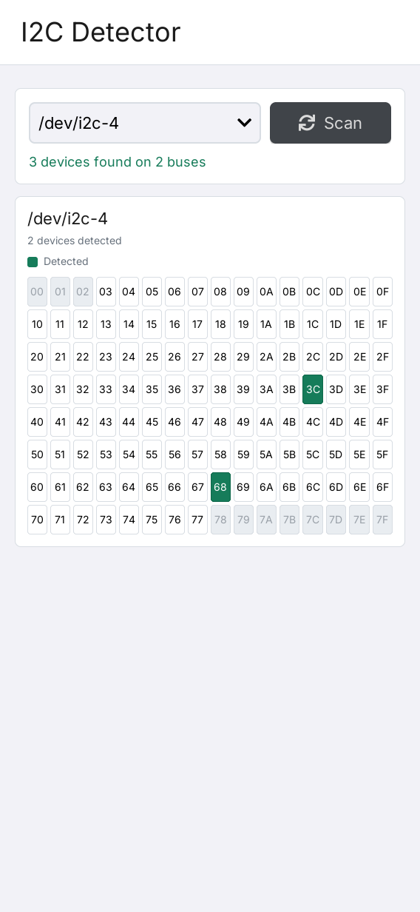

# I2C Detector

[English](README.md) | **简体中文**

I2C Detector 是面向 LILYGO UI 的 Linux I2C 总线检测工具，基于 C++17、
[LILYGO UI AppKit](https://github.com/LILYGO-UI/cm0-appkit) 和 LVGL 9.5 构建。
应用自动发现 `/dev/i2c-*` 适配器，在工作线程中扫描，并以完整的 7-bit
十六进制地址矩阵展示所选总线的结果。

项目提供 CM0 ARM64 Linux 设备构建，以及用于开发和测试的 SDL2 桌面模拟器。

## 预览

<p>
  
</p>

预览使用固定测试数据：两条总线上共检测到三个地址，当前选中 `/dev/i2c-4`。

## 功能

- **自动发现：** 动态枚举总线编号，打开页面时扫描所有发现的适配器，点击 **Scan** 可重新扫描。
- **地址矩阵：** 展示 `0x00`–`0x7F`，探测 `0x03`–`0x77`，范围外的地址灰显。
  绿色表示探测成功，或该地址已被内核驱动占用。
- **总线切换：** 切换查看各总线结果；重新扫描后，若原总线仍存在，则保留选择。
- **状态反馈：** 显示地址数量、未发现适配器、单条总线打开失败及扫描错误。
- **响应式界面：** 支持横竖屏布局，空间不足时地址矩阵可滚动查看。
- **后台扫描：** 设备 I/O 在工作线程执行，扫描完成后一次性更新完整结果。

扫描需要 Linux 的 `i2c-dev` 设备节点，以及运行用户对这些节点的读写权限。
**Linux 桌面模拟器也会扫描真实硬件。** macOS 等非 Linux 主机会提示扫描仅在 Linux
可用；固定演示总线只由测试注入。

探测会执行 SMBus 事务，可能影响连接的设备；常规地址范围并不代表所有设备都能安全接受扫描。
在真实总线上运行前，请阅读[扫描与硬件说明](docs/02-scanning-and-hardware.md)（英文），
了解探测方式、绿色地址及空结果的含义。

## 开发环境搭建

项目标识、版本和软件包元数据由 [`lpm.toml`](lpm.toml) 提供。
[`CMakePresets.json`](CMakePresets.json) 定义了 `host-simulator` 和 `cm0-cross` 配置。
所有项目命令均在仓库根目录执行。

### 获取源码

```sh
git clone --recurse-submodules https://github.com/LILYGO-UI/i2c-detector.git
cd lilygo-ui-i2cdetector
```

已有仓库可使用以下命令初始化锁定版本的依赖：

```sh
git submodule update --init --recursive
```

预设通过 `find_package(LilyGoUI CONFIG REQUIRED)` 直接使用 `third_party/cm0-appkit`，
模拟器无需单独安装 AppKit。默认使用其中附带的 LVGL 9.5.0 源码归档，
两种预设均禁用了 LVGL 网络下载。

### 主机依赖

需要 CMake 3.21 或更高版本（包含 CTest 和 CPack）、Python 3.11 或更高版本，
以及支持 C++17 的 C/C++ 编译器。预设使用 Unix Makefiles；AppKit 还需要 `patch`
来应用附带的 LVGL 补丁。SDL2 提供主机显示，FreeType 负责字体渲染。
Linux 扫描器直接使用内核 I2C 头文件和 `ioctl`，不依赖 `i2c-tools`。

#### Debian 12 / Ubuntu 24.04 或更高版本

```sh
sudo apt update
sudo apt install build-essential cmake git pkg-config patch libsdl2-dev \
  libfreetype6-dev linux-libc-dev python3 python3-venv python3-pip
```

较旧发行版需要先将 CMake 和 Python 升级到上述最低版本。

#### macOS

按需安装 Xcode Command Line Tools，并通过 [Homebrew](https://brew.sh/) 安装依赖。
完成 Homebrew 的 Shell 配置，确保 `brew` 及其安装的工具位于 `PATH` 中：

```sh
xcode-select --install
brew install git cmake pkg-config patch sdl2 freetype python
```

#### LPM

CMake 在配置阶段调用 `lpm metadata --format cmake`。
使用 Python 3.11 或更高版本，在项目虚拟环境中安装 LPM：

```sh
python3 -m venv .venv
. .venv/bin/activate
python -m pip install "git+https://github.com/LILYGO-UI/lpm.git"
lpm --version
```

每次打开新终端后，先执行 `. .venv/bin/activate` 再使用 `lpm`。
CMake 会同时搜索 `.venv/bin` 和 `PATH`。
如需指定其他位置的 LPM，可在配置时传入 `-DLPM_EXECUTABLE=/absolute/path/to/lpm`。

构建前检查主机环境：

```sh
cmake --version
python --version
pkg-config --modversion sdl2 freetype2
lpm metadata --format cmake
```

### 设备交叉编译器

仅构建桌面模拟器时可跳过此步骤。设备构建需要在开发机上单独安装 AArch64 Linux 交叉编译器。

**Debian / Ubuntu：**

```sh
sudo apt install gcc-aarch64-linux-gnu g++-aarch64-linux-gnu
```

**Apple Silicon macOS：**

```sh
brew install aarch64-unknown-linux-gnu
```

BSP 工具链要求 `PATH` 中存在以下名称的可执行文件：

```sh
aarch64-linux-gnu-gcc --version
aarch64-linux-gnu-g++ --version
```

SDK 对主机和编译器的要求详见 [CM0BspBuilder](https://github.com/LILYGO-UI/CM0BspBuilder)。
BSP 提供目标平台的头文件和库，但不会安装开发机所需的交叉编译器。

## 构建与测试

完成环境搭建后，在仓库根目录使用 LPM。
它会从 `lpm.toml` 读取构建预设和打包输出目录。

### 桌面模拟器

```sh
lpm start --foreground
```

此命令会配置、构建模拟器，然后以前台模式启动。
如需复用已有构建产物，执行 `lpm start --no-build --foreground`。
Debug 构建启用测试，产物位于 `build/host-simulator`。
运行应用需要图形桌面会话；硬件扫描仅在 Linux 可用，扫描过程不需要联网。

### 测试

配置、构建主机模拟器并运行全部测试：

```sh
lpm test
```

| 测试 | 覆盖内容 |
| --- | --- |
| `i2cdetector-core` | Model 状态、总线排序、计数、选择保留及空报告和错误报告 |
| `i2cdetector-view-model` | 使用假扫描器验证扫描命令、重复启动拦截、报告轮询、总线切换和 Subject 更新 |
| `i2cdetector-render-portrait` | `568 x 1232` 下的渲染、地址颜色、总线切换和重扫按钮状态 |
| `i2cdetector-render-landscape` | `1232 x 568` 下的同类渲染和交互检查 |

测试使用合成报告，不探测硬件。渲染测试无需 SDL 窗口，将 `i2cdetector-portrait.ppm`
和 `i2cdetector-landscape.ppm` 写入 `build/host-simulator`。
修改 UI 后应检查两张图；断言通过不能验证视觉布局。UI 验收要求见
[UI 开发规范](docs/01-user-interface.md)。真实适配器发现和 SMBus 事务需另行在 Linux 设备验证。

### CM0 设备构建

设备预设面向 AArch64 架构的 CM0 Raspberry Pi OS，使用 Release 构建，
禁用主机测试，并将安装前缀设为 `/usr`。交叉编译并生成 Debian 软件包：

```sh
lpm pack
```

首次执行 `lpm pack`（或 `cmake --preset cm0-cross`）时，
[工具链包装脚本](cmake/cm0-bsp-toolchain.cmake)会下载 CM0 BSP `0.1.0`，
校验锁定的 SHA-256，并将 sysroot 解压到 `.cache/cm0-bsp/0.1.0/sysroot`。
首次下载需要访问 GitHub，后续配置会复用缓存。
如需修改缓存位置，可在配置时传入 `-DCM0_BSP_CACHE_DIR=/absolute/path/to/cache`。
无需在相邻目录克隆 CM0BspBuilder。

SDK sysroot 必须包含目标平台的 Linux I2C 头文件，以及 FreeType 和 DRM 的库与头文件。
主机库不能替代目标平台依赖。

CPack 将 ARM64 `.deb` 输出到 `dist/`。软件包安装可执行文件、启动器条目及图标、
桌面条目、AppStream 元数据和共享字体许可声明。
目标系统需要提供 `libc6`、`libstdc++6`、`libdrm2`、`libfreetype6`
和 `lilygo-ui-appkit-dev >= 0.1.0`，共享运行时字体由 AppKit 提供。
`lpm.toml` 中的 `i2c` 权限声明不会加载内核驱动或授予 `/dev/i2c-*` 的访问权限，
详见[硬件准备](docs/02-scanning-and-hardware.md#linux-setup)（英文）。

<details>
<summary>底层 CMake 命令</summary>

LPM 封装了以下步骤。调试构建配置时也可以直接执行这些命令，但读取项目元数据仍需要 LPM。

主机构建与测试：

```sh
cmake --preset host-simulator
cmake --build --preset host-simulator --parallel
ctest --preset host-simulator
```

设备构建与打包：

```sh
cmake --preset cm0-cross
cmake --build --preset cm0-cross --parallel
cpack --config build/cm0-cross/CPackConfig.cmake -B dist
```

</details>

### 常见问题

| 现象 | 处理方法 |
| --- | --- |
| `lpm is required to read project metadata` | 在 `.venv` 中安装 LPM，将其加入 `PATH`，或设置 `LPM_EXECUTABLE`。 |
| 找不到 `LilyGoUI` 或附带的 LVGL | 执行 `git submodule update --init --recursive`，初始化锁定版本的 AppKit 子模块。 |
| 缺少 SDL2 或 FreeType | 安装主机开发依赖；交叉编译时检查目标 sysroot。 |
| 缺少 Linux I2C 头文件 | Debian/Ubuntu 安装 `linux-libc-dev`；交叉编译时检查目标 sysroot。 |
| 找不到 Homebrew 库 | 使用 `cmake --preset host-simulator -DCMAKE_PREFIX_PATH="$(brew --prefix)"` 配置。 |
| BSP 下载失败 | 检查 GitHub Releases 访问情况和可用磁盘空间，然后重新配置。 |
| 未发现总线、权限错误或未检测到地址 | 详见[硬件故障排查](docs/02-scanning-and-hardware.md#troubleshooting)（英文）。 |

## 文档

| 指南 | 内容 |
| --- | --- |
| [扫描与硬件](docs/02-scanning-and-hardware.md)（英文） | Linux 准备、探测顺序、结果含义、平台差异和故障排查 |
| [架构概览](docs/00-overview.md) | 模块边界、工作线程生命周期、状态转换和构建元数据 |
| [UI 开发规范](docs/01-user-interface.md) | 地址矩阵、布局、字体、所有权和 UI 验证要求 |

## 致谢

Linux 探测顺序参考了
[T-Display-K230 launcher](https://github.com/Xinyuan-LilyGO/T-Display-K230/tree/main/k230_launcher)
中的 I2C 扫描器。界面使用 LILYGO UI AppKit 和 [LVGL](https://lvgl.io/)。
