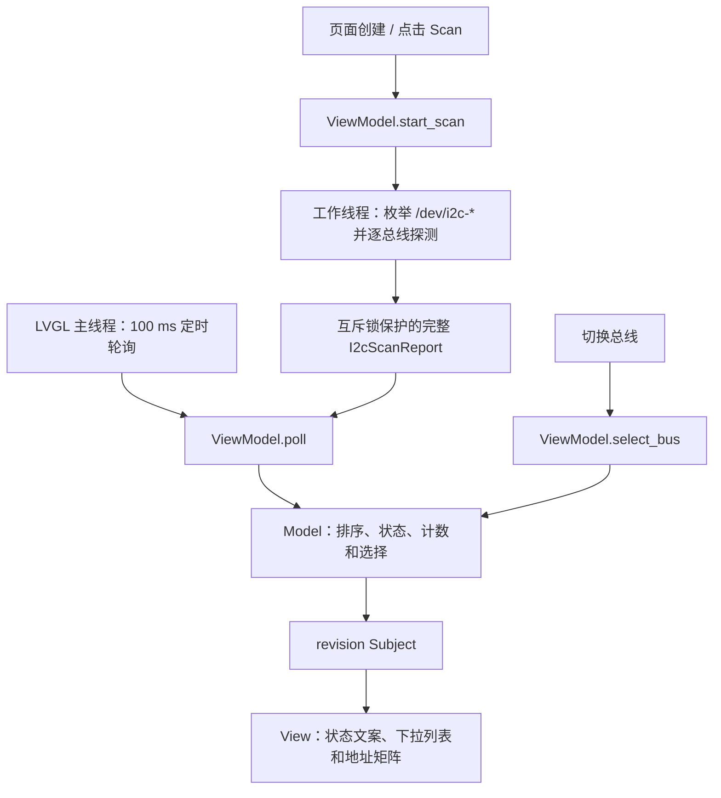

# I2C Detector 架构总览

I2C Detector 是基于 C++17、LILYGO UI AppKit 和 LVGL 9.5 的 Linux I2C 总线检测工具。
设备构建面向 CM0 ARM64 Linux，使用 DRM/KMS；主机模拟器使用 SDL2。
应用通过 `find_package(LilyGoUI CONFIG REQUIRED)` 消费 AppKit，不依赖 Launcher 源码。

项目介绍和环境搭建见[中文 README](../README.zh-CN.md)，编译与打包见
[构建与测试](../README.zh-CN.md#构建与测试)，设备准备和探测细节见
[扫描与硬件说明](02-scanning-and-hardware.md)（英文），界面规则见
[UI 开发规范](01-user-interface.md)。

## 数据流



总线发现和设备 I/O 在单个工作线程中串行执行。线程只返回普通 C++ 数据，不操作
LVGL，也不直接修改 Model。扫描完成后，`poll()` 取走报告，Model 一次性替换结果，
ViewModel 增加 `revision`，由绑定在页面根对象上的 observer 刷新 UI。

100 ms 是完成结果的轮询间隔，不是自动重扫周期。当前实现没有逐地址进度；
新一轮扫描只改变状态，保留上一轮矩阵，直到完整报告到达。

## 模块边界

以下路径均相对仓库根目录；页面私有实现集中在 `src/pages/i2c_detector/`。

| 模块 | 责任 |
| --- | --- |
| [`src/main.cpp`](../src/main.cpp) | 调用 `cm0_app_run()`，将运行时交给 AppKit。 |
| [`src/app.cpp`](../src/app.cpp) | 注册应用描述符，装配 ViewModel/View，管理打开和关闭顺序。 |
| [`i2c_detector_model.*`](../src/pages/i2c_detector/i2c_detector_model.hpp) | 地址范围、报告结构、扫描状态、总线排序、计数和选择保留；不依赖 LVGL。 |
| [`i2c_scanner.*`](../src/pages/i2c_detector/i2c_scanner.hpp) | 可注入的扫描器接口、Linux 总线发现、SMBus 探测和工作线程生命周期。 |
| [`i2c_detector_view_model.*`](../src/pages/i2c_detector/i2c_detector_view_model.hpp) | 扫描、轮询和选择命令，将 Model 转换为展示文案并通过 Subject 通知变化。 |
| [`i2c_detector_view.*`](../src/pages/i2c_detector/i2c_detector_view.hpp) | LVGL 控件、地址矩阵、尺寸响应、事件转发和轮询定时器。 |
| [`src/components/`](../src/components/) | 语义颜色、通用控件及 Subject RAII 封装。 |

`lilygo_ui_i2cdetector_core` 编译 Model 和 Scanner，只链接线程库；
`lilygo_ui_i2cdetector_ui` 编译应用、ViewModel、View 和组件，链接 core 与
`LilyGoUI::Runtime`。Model 测试无需初始化 LVGL。当前只有一个页面，无独立路由器或共享领域目录。

## 状态与结果

| 状态 | 触发条件 | 展示行为 |
| --- | --- | --- |
| `ready` | ViewModel 刚创建 | 显示 `Ready to scan`；页面创建后随即请求扫描。 |
| `scanning` | 成功启动扫描器 | 显示扫描中，禁用 Scan；已有结果和总线切换仍可使用。 |
| `complete` | 报告包含总线且无全局错误 | 显示所有总线上的命中地址总数，并附不可用总线数量。 |
| `no_buses` | 报告无总线且无全局错误 | 显示 `No I2C buses found`，禁用总线选择器。 |
| `error` | 线程启动、发现总线或其他全局错误 | 显示错误文本；非 Linux 平台也通过此状态说明扫描不可用。 |

结果按 `bus_number` 升序排列。重扫后按总线编号恢复原选择；原总线消失则选择
排序后的第一条。没有总线时，`selected_bus()` 返回空指针。

单条总线打开失败记录在 `I2cBusScanResult::error`，其他总线继续扫描；选中该总线时显示
`Bus unavailable: ...`。即使全部总线都无法打开，只要报告仍包含总线且没有全局错误，
整体状态仍为 `complete`，因此不能仅凭完成状态判断所有总线可用。

`detected` 为每条总线的 128 项布尔数组。成功探测与内核驱动占用都记为 `true`，
不区分二者；界面中的 device 数量实际是命中地址数，不是识别出的物理设备数。
单个地址探测失败不会记录独立错误，也不能据此认定该地址没有设备。

## 扫描器与生命周期

`I2cScanner` 提供 `start()`、`running()` 和 `take_result()`。默认实现为
`SystemI2cScanner`；ViewModel 和渲染测试通过构造函数注入假扫描器。
是否扫描真实硬件仅取决于 `__linux__`，与 SDL2/DRM 显示后端无关。

- `start()` 拒绝正在运行的重复请求，回收上一工作线程，清空待取报告，再启动新线程。
- 工作线程通过原子变量报告运行/取消状态，通过互斥锁保护单个待取结果。
  `take_result()` 移走报告并回收线程，同一报告只交付一次。
- AppKit 关闭应用时，先销毁 View，再释放 ViewModel。View 删除轮询定时器，
  删除页面根对象及其子对象，随后清空缓存指针；对象绑定的 observer 随根对象删除。
- Scanner 随 ViewModel 销毁，设置取消标记并等待工作线程退出。取消在总线和地址之间检查，
  不会中断正在执行的内核 `ioctl`，因此退出耗时可能受驱动超时影响。

ViewModel 必须比订阅其 Subject 的 View 存活更久；后台线程不得访问 LVGL。
新增扫描后端时应保留接口与线程边界，让展示层测试继续使用可重复的合成报告。

## 配置与打包

[`lpm.toml`](../lpm.toml) 是开发者维护的项目元数据源，当前身份如下：

| 字段 | 值 |
| --- | --- |
| 软件包与可执行文件 | `lilygo-ui-i2cdetector` |
| 应用 ID / Desktop / AppStream ID | `cc.lilygo.ui.I2cDetector` |
| 应用标题 | `I2C Detector` |
| 设备架构 | `arm64` |
| 最低 AppKit 版本 | `0.1.0` |
| 权限声明 | `i2c`，用于说明适配器发现及地址探测需求 |

CMake 在配置阶段调用 LPM 读取元数据，再由 `cmake/app_identity.h.in` 和 `data/*.in`
生成应用身份头文件、Launcher manifest、desktop 条目和 AppStream 元数据。
生成文件不应成为第二份手工维护的配置。

设备预设将安装前缀设为 `/usr`，安装可执行文件、Launcher 条目和图标、Desktop/AppStream
条目及共享字体许可；字体文件由 AppKit 在设备上提供。预览图用于项目展示，不进入应用 deb。
权限声明本身不会修改 Linux 设备节点权限。构建、依赖和打包命令统一见 README。

`.cache/`、`.lpm/`、`.venv/`、`build/` 和 `dist/` 是本地状态或生成物，不应提交。
`publish.json` 是发布流程派生数据，不是配置入口，不应手工维护或生成在仓库根目录。

## 验证范围

主机配置、构建与测试：

```sh
cmake --preset host-simulator
cmake --build --preset host-simulator --parallel
ctest --preset host-simulator
```

四项测试分别验证 Model、使用假扫描器的 ViewModel，以及 `568 x 1232` 和
`1232 x 568` 两种视口的渲染及主要交互，具体覆盖见
[README 测试说明](../README.zh-CN.md#测试)。测试不会访问真实 I2C 设备。

修改 UI 时应按 [UI 开发规范](01-user-interface.md#测试覆盖与验收)检查两种视口产物，并手动验证
紧凑宽度、尺寸切换、长错误文案和滚动可达性；现有自动测试未完整覆盖这些情况。
修改扫描实现时还需在适合探测的 Linux 总线上验证发现、权限错误和探测结果。
修改 SDK、工具链、安装或打包规则时应完成 `cm0-cross` 构建和 Debian 打包验证。
